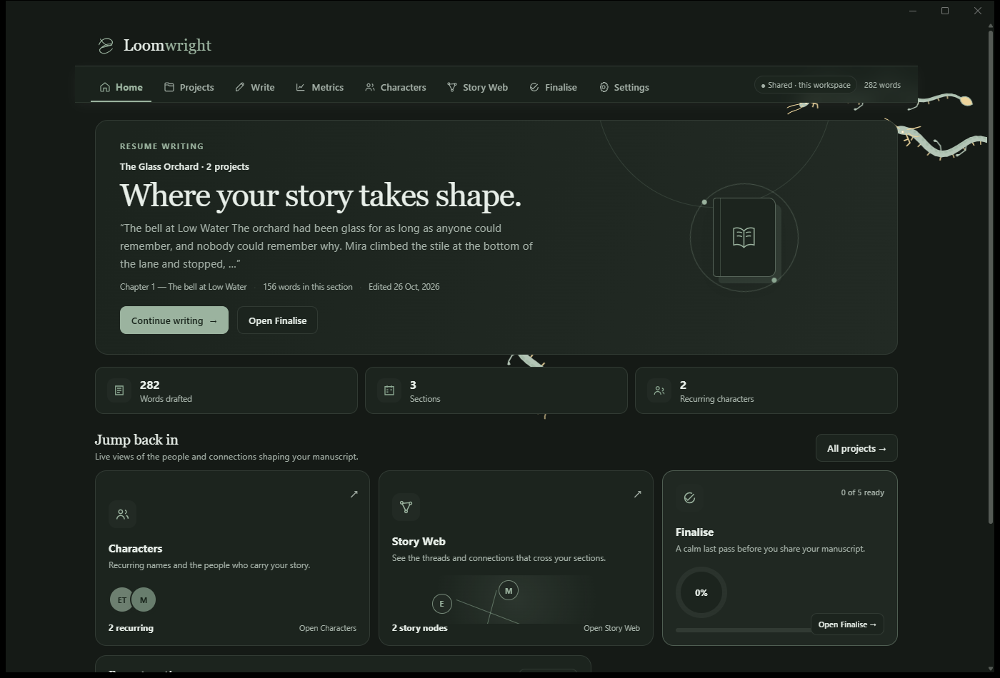
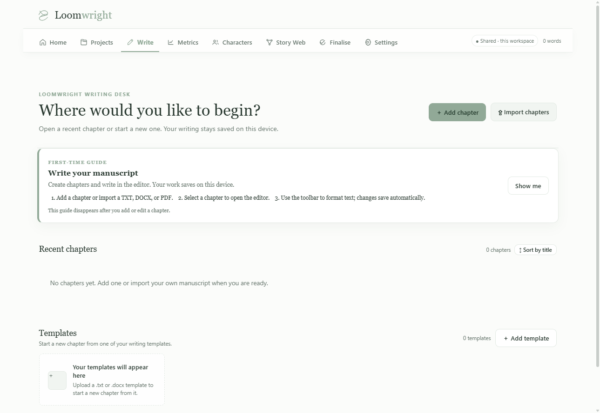
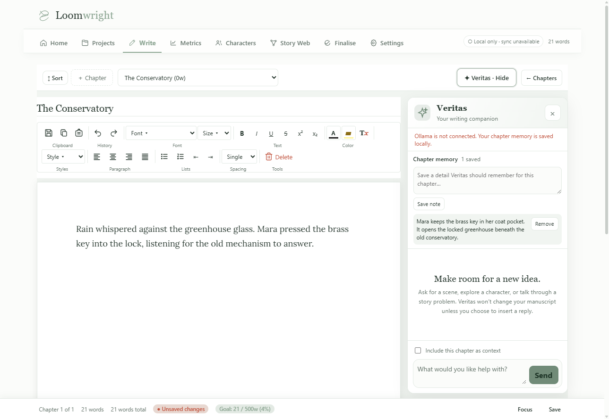

# Loomwright Desktop

The Loomwright writing desk as a native Windows application.

`loomwright.exe` is a small Rust program that opens a real Win32 window and hosts
the original Loomwright interface in **WebView2** — the Chromium engine that ships
with Windows 10 and 11. The interface, its stylesheet, fonts, animations and
JavaScript are the application itself; Rust owns the process, the window, the
local service and the installer.



---

## Features

**Writing**
- Project library with multiple books, each with its own chapters, cast, map and
  front matter.
- Rich-text chapter editor (headings, bold/italic/underline, colour, highlight,
  font, size, line spacing, quotes, lists) with autosave.
- Chapter import from **DOCX, PDF and TXT**, cleaned and sanitised before it
  enters the manuscript, with ZIP/macro/embedded-object screening for Word files.
  When splitting a full manuscript, Loomwright skips contents-page entries and
  preliminary pages, then starts chapters at the actual chapter headings.
- Reusable chapter templates (`.txt` / `.docx`).
- Word and character counts, per-chapter and whole-manuscript, with a daily goal.
- Focus mode, typewriter scrolling and a distraction-free zen mode.

**Story tools**
- Offline character recognition: scans the manuscript for recurring people using
  capitalisation and narrative-context signals, with strict/balanced/loose
  sensitivity, review tray, aliases, merging, roles, notes and per-chapter
  appearance counts.
- Story web: a draggable map of places, events, objects and threads with links.
- Veritas writing companion powered by Ollama, with installed-model selection,
  optional manuscript context, and explicit controls for inserting replies.
- Chapter-specific Veritas chat history and saved memory notes, stored with the
  project and never added to the manuscript automatically.
- Project-wide Veritas story memory for continuity facts shared across all
  chapters, while keeping each chapter's existing memory separate.
- Explicit chapter links let Veritas compare linked chapter text and events
  when helping with continuity; links and excerpts are limited for privacy and
  request size.
- Separate project-scoped Veritas conversations for Metrics, Characters, and
  Story Web, with optional view-specific context.

**Finishing**
- Book designer: title, subtitle, author, dedication, cover style, trim size,
  interior typeface, cover art upload (JPG/PNG/WebP, resized and stored locally)
  and a live preview of the opening pages.
- Readiness checklist.
- Export to plain text, formatted HTML (print-ready) and Markdown.

**Appearance and data**
- Light and dark themes, five colour palettes, eight bundled typefaces, zen
  background effects.
- Projects and Veritas chapter memory live in the app's WebView2 profile;
  exports go to `Documents\Loomwright`. The app has no telemetry. Veritas sends
  only your chat and any context you opt to include to Ollama; cloud models may
  process requests outside this device.
- Two Loomwright windows on the same machine share projects through a small
  loopback service (`/api/sync`).

**Desktop integration**
- Native window with the standard minimise / maximise / close controls, resizable
  from 980 × 640, taskbar and Alt+Tab entry.
- Themed caption bar: it follows the app's current background colour, hides the
  logo and title, and shows only the window buttons.
- Per-user installer (no administrator rights), Start-menu and optional desktop
  shortcuts, Add/Remove Programs entry, silent-install support, and an uninstaller
  that keeps your manuscripts.

## Requirements

- Windows 10 or 11, x64.
- The **WebView2 runtime**. It is installed by default with Microsoft Edge on
  Windows 10/11; if it is missing, install the Evergreen runtime from Microsoft.
- To build the installers: Rust (tested with 1.99), a linker (MinGW-w64 or
  MSVC), NSIS 3 and WiX Toolset v3.11.

## Download & Install

Download the current v1.6.0.4.6 installer from [**GitHub Releases**](https://github.com/soloanalysis28-dev/loomwright-desktop/releases/latest):

| Format | File | Recommended For |
|---|---|---|
| **EXE** | [`Loomwright-Setup-1.6.0.4.6.exe`](https://github.com/soloanalysis28-dev/loomwright-desktop/releases/download/v1.6.0.4.6/Loomwright-Setup-1.6.0.4.6.exe) | Standard Windows setup with desktop & start menu shortcuts |
| **MSI** | [`Loomwright-Setup-1.6.0.4.6.msi`](https://github.com/soloanalysis28-dev/loomwright-desktop/releases/download/v1.6.0.4.6/Loomwright-Setup-1.6.0.4.6.msi) | Windows Installer package (enterprise / scripted deployments) |

**Manuscript import in the writing desk**



**Veritas memory and chapter links**



Story memory is shared by Veritas across the project; chapter memory remains
private to its chapter. Link up to five chapters from the Write sidebar so
Veritas can compare their text and continuity details. These saved notes and
links are stored with the project.

Both installers are also saved in the repository's [`installer/`](./installer/)
folder after a local build. Run either installer. It installs to
`%LOCALAPPDATA%\Programs\Loomwright` without elevation (no administrator
rights needed) and starts Loomwright when it finishes.

Uninstall from **Settings → Apps**, or from the Start-menu folder; the uninstaller removes the application but leaves your manuscripts in place.

> **Fresh install — zero pre-loaded data.** Loomwright starts with an empty
> project library and no sample books, chapters, characters, or story nodes.
> Create a project when you are ready; first-use guides introduce the core
> features and disappear after you use each one.

## Build

You can build the application and both installers locally using PowerShell:

```powershell
# Build the binary, .exe (NSIS), and .msi (WiX)
.\tools\build-installers.ps1 -Version 1.6.0.4.6
```

Or step-by-step:

```powershell
# 1. Build application binary
cd loomwright-window
$env:LOOMWRIGHT_DISPLAY_VERSION = "1.6.0.4.6"
cargo build --release          # → target\release\loomwright.exe

# 2. Build NSIS (.exe) installer
cd ..\installer
makensis /DVERSION=1.6.0.4.6 /DFILE_VERSION=1.6.0.4006 loomwright.nsi # → Loomwright-Setup-1.6.0.4.6.exe

# 3. Build WiX (.msi) installer (requires WiX Toolset v3)
candle "-dVersion=1.12.4006" "-dDisplayVersion=1.6.0.4.6" loomwright.wxs -out loomwright.wixobj
light -sval loomwright.wixobj -out Loomwright-Setup-1.6.0.4.6.msi
```

The app and installer display version is `1.6.0.4.6`. Windows executable file
metadata uses `1.6.0.4006`; the MSI database uses `1.12.4006`, packing the final
two display-version components into its build field because Windows Installer
accepts only three numeric fields. Its major/minor pair follows the earlier MSI
version line so this release upgrades prior installs; Apps & Features retains
the full display version. Future releases increment the MSI build field, and
the installer rejects genuine downgrades.

To use Veritas, install Ollama and at least one model, then enable it under
**Settings → Veritas**. Story memory is shared across the project; chapter
memory stays scoped to its chapter. Explicitly linked chapters and saved memory
are included as continuity references, while manuscript context inclusion and
adding replies to the draft remain separate actions.

`.cargo/config.toml` selects the MinGW `gcc` linker for the
`x86_64-pc-windows-gnu` target. On a standard MSVC toolchain, delete that file
(or the `[target...]` section) and build normally.

The front end is embedded at compile time from `loomwright-window/web/`
(`include_dir!`), so the executable is self-contained — no asset folder needs to
ship beside it.

## Architecture

```
loomwright.exe  (single Rust process)
├── tao          Win32 window: caption, resize, taskbar, Alt+Tab
├── wry          WebView2 control filling the client area
│                 └── http://127.0.0.1:47832 → the interface
├── std::net     loopback service (threads, no async runtime)
│     ├── GET  /…            embedded assets (HTML/CSS/JS/fonts/vendor)
│     ├── GET  /api/app-status
│     ├── GET  /api/sync     shared project snapshot
│     ├── PUT  /api/sync     revision-checked save
│     └── /api/git/*         desktop stub (updates ship via the installer)
├── DWM          caption colour, hidden title, transparent caption icon
└── winres       icon + version metadata embedded in the executable
```

| Path | Purpose |
|---|---|
| `loomwright-window/src/main.rs` | window, WebView2 host, caption theming, icon |
| `loomwright-window/src/server.rs` | loopback static/API service |
| `loomwright-window/src/assets.rs` | embedded asset table and MIME types |
| `loomwright-window/web/` | the Loomwright interface (HTML, CSS, JS, fonts, PDF.js, Mammoth, DOMPurify, fflate) |
| `loomwright-window/build.rs` | Windows resource (icon, version) |
| `installer/` | NSIS script, application icon, installed README |

The caption is themed from the page itself: a small injected script reports the
live CSS `--bg` value over the WebView2 IPC bridge whenever `data-theme` or
`data-palette` changes, and the shell applies it to the DWM caption, text and
border colours. The small caption icon is a transparent 16 × 16 icon so no logo
appears; the large icon remains for the taskbar.

## Data

| What | Where |
|---|---|
| Projects, settings, characters | `%LOCALAPPDATA%\Loomwright\WebView2` (browser profile) |
| Shared snapshot (two windows) | `%APPDATA%\Loomwright\shared.json` |
| Exports and backups | `%USERPROFILE%\Documents\Loomwright` |

### Fresh-install behaviour (v1.6.0+)

A new installation starts with **no pre-loaded data**. The app opens to an empty
project library and prompts the user to create their first project. No sample
chapters, characters or story nodes are pre-populated.

Projects created by a user are retained in the WebView2 profile and shared store
when the app is upgraded or reinstalled. The installers do not delete
`shared.json`; the app filters the known bundled demo project and generated
empty starter placeholders while preserving meaningful existing manuscripts.
On first use, contextual guides appear for Projects, Writing, Metrics,
Characters, Story Web, and Finalise. Each guide is saved as complete after the
corresponding feature is first used.

## Privacy

The app has no telemetry, no analytics and no remote API. The page's CSP is
`connect-src 'self'`, and `'self'` is the loopback service bound to
`127.0.0.1:47832`. Removing the network cable changes nothing.

## Known limitations

- **The WebView2 runtime is required.** It ships with Windows 10/11, and if it is
  missing the app now explains the problem and offers Microsoft's download page
  instead of opening a blank window. A fully offline installer can bundle
  Microsoft's 1.8 MB bootstrapper and run it during setup (needs elevation) — a
  small addition to `installer/loomwright.nsi` if you want it.
- **The binaries are unsigned**, so SmartScreen warns on first run. Fixing this
  needs a real code-signing certificate (EV for immediate reputation, OV builds
  reputation over downloads); `tools/sign.ps1` signs the executable and the
  installer with `signtool` and a timestamp.
- **One window.** A single document window per process, by design. Multiple
  windows would mean one WebView2 per window sharing a single environment, plus a
  "New window" command; project sharing is already solved by the loopback service,
  which is why two separate launches share data today.
- Settings → *Offline & storage* and *About* are rewritten for the desktop by
  `loomwright-window/web/desktop.js` (bundled files instead of "prepare offline",
  release link instead of the development Git sync card). The page's own wording
  is untouched; the desktop script adjusts it at runtime.

## Changelog

### 1.6.0.2
- Fixed the WiX build invocation so the MSI compiles with its four-part public
  version and publishes alongside the EXE.
- Both setup packages and the app now report version `1.6.0.2`.
- Large DOCX, PDF, and TXT manuscript imports now detect explicit chapter
  headings such as `Chapter 1`, `Chapter One`, `Prologue`, and `Epilogue`,
  creating separate chapters automatically while preserving formatting.
- Documents without multiple reliable chapter boundaries continue to import as
  one chapter.
- New installations open to a truly empty project library and chapters are
  created only when the user asks for them.
- Added persistent, action-based first-use guides for the core features.
- Installer upgrades now preserve shared user manuscripts while filtering
  known demo/empty starter data in the app.

### 1.6.0.2.5
- Import splitting now ignores linked/table-of-contents entries, page-number
  leaders and preliminary pages, and starts chapters at actual manuscript
  headings.
- Chapter headings in a contents page no longer become duplicate chapters;
  single-chapter manuscripts with a contents page are still extracted.
- The Rust build embeds a Windows-compatible file version derived from the
  five-part public version, and both installers display the complete version.
- Added a chapter-import screenshot to the project and release page.

### 1.0.6.3
- Added Veritas, an Ollama-powered writing companion with model selection and
  optional manuscript context.
- Added chapter-specific Veritas conversation history and manually saved
  memory notes, with explicit controls for inserting generated text.
- Expanded the Veritas UI screenshots and updated both Windows installer
  packages and their displayed version.

### 1.6.0 (2026-10-30)
- **Clean-slate install**: every new installation starts with an empty project
  library. No sample or demo content is pre-loaded.
- Runtime cleanup strips the known `"p-demo"` sentinel project from shared data.
- App version reported in Settings updated to `1.6.0.0`.

## Licence

No licence is declared for the original Loomwright project, so this repository
carries the same status: all rights reserved by the author. Bundled third-party
libraries keep their own licences — see the notices under
`loomwright-window/web/vendor/licenses/` and
`loomwright-window/web/fonts/licenses/`.
