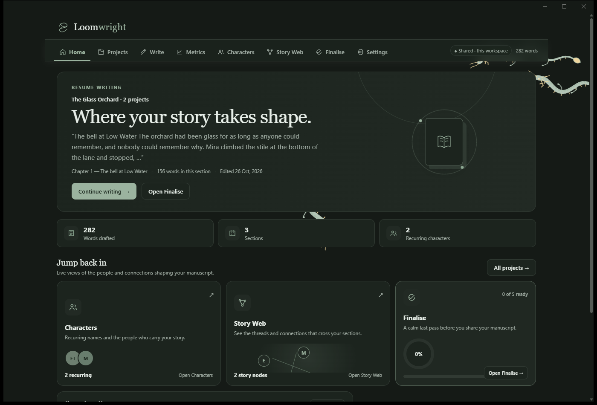

# Loomwright Desktop

The Loomwright writing desk as a native Windows application.

`loomwright.exe` is a small Rust program that opens a real Win32 window and hosts
the original Loomwright interface in **WebView2** — the Chromium engine that ships
with Windows 10 and 11. The interface, its stylesheet, fonts, animations and
JavaScript are the application itself; Rust owns the process, the window, the
local service and the installer.



---

## Features

**Writing**
- Project library with multiple books, each with its own chapters, cast, map and
  front matter.
- Rich-text chapter editor (headings, bold/italic/underline, colour, highlight,
  font, size, line spacing, quotes, lists) with autosave.
- Chapter import from **DOCX, PDF and TXT**, cleaned and sanitised before it
  enters the manuscript, with ZIP/macro/embedded-object screening for Word files.
- Reusable chapter templates (`.txt` / `.docx`).
- Word and character counts, per-chapter and whole-manuscript, with a daily goal.
- Focus mode, typewriter scrolling and a distraction-free zen mode.

**Story tools**
- Offline character recognition: scans the manuscript for recurring people using
  capitalisation and narrative-context signals, with strict/balanced/loose
  sensitivity, review tray, aliases, merging, roles, notes and per-chapter
  appearance counts.
- Story web: a draggable map of places, events, objects and threads with links.

**Finishing**
- Book designer: title, subtitle, author, dedication, cover style, trim size,
  interior typeface, cover art upload (JPG/PNG/WebP, resized and stored locally)
  and a live preview of the opening pages.
- Readiness checklist.
- Export to plain text, formatted HTML (print-ready) and Markdown.

**Appearance and data**
- Light and dark themes, five colour palettes, eight bundled typefaces, zen
  background effects.
- Everything is local: projects live in the app's WebView2 profile, exports go to
  `Documents\Loomwright`, and the app makes no network requests.
- Two Loomwright windows on the same machine share projects through a small
  loopback service (`/api/sync`).

**Desktop integration**
- Native window with the standard minimise / maximise / close controls, resizable
  from 980 × 640, taskbar and Alt+Tab entry.
- Themed caption bar: it follows the app's current background colour, hides the
  logo and title, and shows only the window buttons.
- Per-user installer (no administrator rights), Start-menu and optional desktop
  shortcuts, Add/Remove Programs entry, silent-install support, and an uninstaller
  that keeps your manuscripts.

## Requirements

- Windows 10 or 11, x64.
- The **WebView2 runtime**. It is installed by default with Microsoft Edge on
  Windows 10/11; if it is missing, install the Evergreen runtime from Microsoft.
- To build: Rust (tested with 1.99), a linker (MinGW-w64 or MSVC) and,
  optionally, NSIS 3 for the installer.

## Install

Run `Loomwright-Setup-3.0.0.exe`. It installs to
`%LOCALAPPDATA%\Programs\Loomwright` without elevation and starts Loomwright when
it finishes. Uninstall from Settings → Apps, or from the Start-menu folder; the
uninstaller removes the application but leaves your manuscripts in place.

## Build

```powershell
cd loomwright-window
cargo build --release          # → target\release\loomwright.exe

cd ..\installer
makensis /DVERSION=3.0.0 loomwright.nsi   # → Loomwright-Setup-3.0.0.exe
```

`.cargo/config.toml` selects the MinGW `gcc` linker for the
`x86_64-pc-windows-gnu` target. On a standard MSVC toolchain, delete that file
(or the `[target...]` section) and build normally.

The front end is embedded at compile time from `loomwright-window/web/`
(`include_dir!`), so the executable is self-contained — no asset folder needs to
ship beside it.

## Architecture

```
loomwright.exe  (single Rust process)
├── tao          Win32 window: caption, resize, taskbar, Alt+Tab
├── wry          WebView2 control filling the client area
│                 └── http://127.0.0.1:47832 → the interface
├── std::net     loopback service (threads, no async runtime)
│     ├── GET  /…            embedded assets (HTML/CSS/JS/fonts/vendor)
│     ├── GET  /api/app-status
│     ├── GET  /api/sync     shared project snapshot
│     ├── PUT  /api/sync     revision-checked save
│     └── /api/git/*         desktop stub (updates ship via the installer)
├── DWM          caption colour, hidden title, transparent caption icon
└── winres       icon + version metadata embedded in the executable
```

| Path | Purpose |
|---|---|
| `loomwright-window/src/main.rs` | window, WebView2 host, caption theming, icon |
| `loomwright-window/src/server.rs` | loopback static/API service |
| `loomwright-window/src/assets.rs` | embedded asset table and MIME types |
| `loomwright-window/web/` | the Loomwright interface (HTML, CSS, JS, fonts, PDF.js, Mammoth, DOMPurify, fflate) |
| `loomwright-window/build.rs` | Windows resource (icon, version) |
| `installer/` | NSIS script, application icon, installed README |

The caption is themed from the page itself: a small injected script reports the
live CSS `--bg` value over the WebView2 IPC bridge whenever `data-theme` or
`data-palette` changes, and the shell applies it to the DWM caption, text and
border colours. The small caption icon is a transparent 16 × 16 icon so no logo
appears; the large icon remains for the taskbar.

## Data

| What | Where |
|---|---|
| Projects, settings, characters | `%LOCALAPPDATA%\Loomwright\WebView2` (browser profile) |
| Shared snapshot (two windows) | `%APPDATA%\Loomwright\shared.json` |
| Exports and backups | `%USERPROFILE%\Documents\Loomwright` |

## Privacy

The app has no telemetry, no analytics and no remote API. The page's CSP is
`connect-src 'self'`, and `'self'` is the loopback service bound to
`127.0.0.1:47832`. Removing the network cable changes nothing.

## Known limitations

- **The WebView2 runtime is required.** It ships with Windows 10/11, and if it is
  missing the app now explains the problem and offers Microsoft's download page
  instead of opening a blank window. A fully offline installer can bundle
  Microsoft's 1.8 MB bootstrapper and run it during setup (needs elevation) — a
  small addition to `installer/loomwright.nsi` if you want it.
- **The binaries are unsigned**, so SmartScreen warns on first run. Fixing this
  needs a real code-signing certificate (EV for immediate reputation, OV builds
  reputation over downloads); `tools/sign.ps1` signs the executable and the
  installer with `signtool` and a timestamp.
- **One window.** A single document window per process, by design. Multiple
  windows would mean one WebView2 per window sharing a single environment, plus a
  "New window" command; project sharing is already solved by the loopback service,
  which is why two separate launches share data today.
- Settings → *Offline & storage* and *About* are rewritten for the desktop by
  `loomwright-window/web/desktop.js` (bundled files instead of "prepare offline",
  release link instead of the development Git sync card). The page's own wording
  is untouched; the desktop script adjusts it at runtime.

## Licence

No licence is declared for the original Loomwright project, so this repository
carries the same status: all rights reserved by the author. Bundled third-party
libraries keep their own licences — see the notices under
`loomwright-window/web/vendor/licenses/` and
`loomwright-window/web/fonts/licenses/`.
